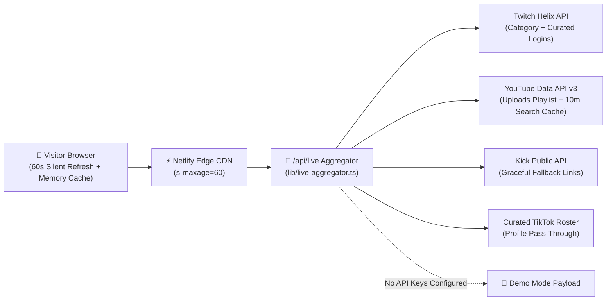

<div align="center">


<br />

# 🌴 ZEUTUBE FM

**Vice Coast Live Streamer Directory for Grand Theft Auto VI**

*See who is live across YouTube, Twitch, Kick, and TikTok right now — zero login, instant platform switching, built for fast mobile data.*

<br />

<!-- Streaming Platforms & Live Capabilities -->
<p>
  <a href="#platform--api-architecture"></a>
  <a href="#platform--api-architecture"></a>
  <a href="#platform--api-architecture"></a>
  <a href="#platform--api-architecture"></a>
  <a href="#platform--api-architecture"></a>
</p>

<!-- Tech Stack, Edge Cache & Spotlight -->
<p>
  
  
  
  
  
  
</p>

<p>
  <a href="#key-features"><strong>Features</strong></a> ·
  <a href="#platform--api-architecture"><strong>Architecture</strong></a> ·
  <a href="#vice-sunset-palette"><strong>Palette</strong></a> ·
  <a href="#quick-customization"><strong>Customize</strong></a> ·
  <a href="#local-development"><strong>Local Setup</strong></a> ·
  <a href="#deploying-to-netlify"><strong>Deploy to Netlify</strong></a>
</p>

</div>

---

## Welcome to Leonida

**Zeutube fm** is a fast, mobile-first live broadcast directory built to answer one question in under a second: **who is playing Grand Theft Auto VI live right now, and where can I watch them?**

No sign-in walls. No bloated player embeds. Open the page, scan the Vice sunset grid, and tap straight into the creator's broadcast on **YouTube**, **Twitch**, **Kick**, or **TikTok**.

---

## Key Features

<table>
  <tr>
    <td width="50%" valign="top">
      <h3>⚡ Instant Platform Filtering</h3>
      <p>Switch seamlessly between <code>All</code>, <code>YouTube</code>, <code>Twitch</code>, <code>Kick</code>, and <code>TikTok</code> with zero page reloads or redundant fetches — the latest response stays cached in memory.</p>
    </td>
    <td width="50%" valign="top">
      <h3>🎛️ Unified Multi-Platform Cards</h3>
      <p>Simulcasting creators like <strong>Kai Cenat</strong> or <strong>IShowSpeed</strong> appear on <strong>one clean card</strong> with a dedicated watch button for each active live platform.</p>
    </td>
  </tr>
  <tr>
    <td width="50%" valign="top">
      <h3>🔥 Featured & 🇰🇪 Kenyan Spotlights</h3>
      <p>Promotes flagship creators in the <strong>Featured Live</strong> row at the top, plus a dedicated <strong>Kenyan Streamers</strong> section highlighted with a <code>🇰🇪 KE</code> badge.</p>
    </td>
    <td width="50%" valign="top">
      <h3>📱 Built for 360px & Fast Data</h3>
      <p>Immediate skeleton cards, lazy-loaded 16:9 thumbnails with fixed aspect dimensions, zero heavy UI libraries, and quiet 60-second background refreshes.</p>
    </td>
  </tr>
</table>

- **Live Search & Smart Sorting** — Filter by streamer name in real time and sort by **Most viewers** (default) or **Newest live**.
- **Offline Curated Roster** — Muted `"Not live right now"` section at the bottom with direct channel links.
- **Automatic Demo Mode** — Runs out of the box with realistic demo broadcasts and a subtle `Demo data` indicator whenever API keys are omitted.

---

## Platform & API Architecture

All third-party API calls execute strictly on the server inside [`lib/live-aggregator.ts`](lib/live-aggregator.ts), exposed through both [`app/api/live/route.ts`](app/api/live/route.ts) (Next.js) and [`netlify/functions/live.ts`](netlify/functions/live.ts) (Netlify Functions).



| Platform | Integration Strategy | Caching & Resilience |
| :--- | :--- | :--- |
| **Twitch** | Official Helix API (`client_credentials`), GTA VI category lookup + batched curated login checks | `60s` edge CDN cache (`s-maxage=60`) |
| **YouTube** | Quota-safe curated checks (`channels` → `playlistItems` → single batched `videos.list`) | Category `search.list` throttled to **once per 10 mins** in memory |
| **Kick** | Official public API client credentials with short timeout | Fails gracefully to curated channel links if unavailable |
| **TikTok** | Curated creator pass-through (`Check on TikTok` buttons) | No unverified live claims (no public live API) |
| **Demo Mode** | Activates automatically when API keys are omitted | Displays realistic live/offline preview + subtle `Demo data` tag |

---

## Vice Sunset Palette

Designed around a dark tropical neon dusk mood — high contrast, crisp tabular numerals, and `prefers-reduced-motion` support:

| Swatch | Token | Hex | Usage |
| :---: | :--- | :--- | :--- |
|  | **Midnight Base** | `#0B0614` | Primary canvas background |
|  | **Velvet Card** | `#170B2A` | Streamer card & toolbar surfaces |
|  | **Neon Pink** | `#FF2E93` | Gradient start, active focus & TikTok accents |
|  | **Sunset Orange** | `#FF8A3D` | Gradient mid-stop & featured accents |
|  | **Golden Yellow** | `#FFD23F` | Headline highlights & demo mode indicator |
|  | **Electric Purple** | `#7B2FF7` | Gradient end & Twitch accents |
|  | **Tropical Teal** | `#00E5C7` | Kenyan Streamers spotlight & Kick accents |
|  | **Live Crimson** | `#FF3B3B` | Pulsing `LIVE` status badge |

---

## Quick Customization

### 1. Rename the App
All branding (`navbar`, `<title>`, OpenGraph tags, and footer) reads from a single constant in [`lib/config.ts`](lib/config.ts):

```ts
export const APP_CONFIG = {
  APP_NAME: 'Zeutube fm',
  // ...
};
```

### 2. Edit Curated Streamers
Update [`streamers.json`](streamers.json) at the project root:

```json
{
  "id": "kai-cenat",
  "displayName": "Kai Cenat",
  "avatarUrl": "",
  "featured": true,
  "country": "US",
  "youtubeChannelId": "TODO_YOUTUBE_CHANNEL_ID",
  "twitchLogin": "kaicenat",
  "kickSlug": "TODO_KICK_SLUG",
  "tiktokUsername": "kaicenat"
}
```

- Set `"featured": true` to pin the creator to the **Featured Live** row.
- Set `"country": "KE"` to highlight the creator in the **Kenyan Streamers** section with a `🇰🇪 KE` badge.
- Leave unknown handles prefixed with `TODO_` — they are ignored safely until filled in.

---

## Local Development

```bash
# 1. Install dependencies
npm install

# 2. Configure optional API keys (omit to run in Demo Mode)
cp .env.example .env.local

# 3. Start the development server
npm run dev
```

### Run Tests & Checks

```bash
# Pure logic & aggregator unit tests (node:test)
npx --yes tsx --test lib/stream-utils.test.ts lib/live-aggregator.test.ts

# TypeScript build & ESLint
npm run build
npm run lint
```

---

## Deploying to Netlify

`netlify.toml` is preconfigured for Next.js + Netlify Functions (`netlify/functions/live.ts`) with edge CDN caching:

1. Push this repository to GitHub, GitLab, or Bitbucket.
2. Create a new site in **Netlify** from your repository:
   - **Build command**: `npm run build`
   - **Publish directory**: `.next`
   - **Functions directory**: `netlify/functions`
3. Add your environment variables under **Site configuration → Environment variables**:
   - `YOUTUBE_API_KEY`
   - `TWITCH_CLIENT_ID`
   - `TWITCH_CLIENT_SECRET`
   - `KICK_CLIENT_ID` *(optional)*
   - `KICK_CLIENT_SECRET` *(optional)*
4. Deploy. Requests to `/api/live` automatically route to `/.netlify/functions/live` and cache at Netlify's edge CDN for 60 seconds (`Netlify-CDN-Cache-Control: public, s-maxage=60, stale-while-revalidate=120`).

---

## Project Structure

```text
├── app/
│   ├── api/live/route.ts       # Next.js server endpoint for live streams
│   ├── globals.css             # Vice sunset palette & reduced-motion rules
│   ├── layout.tsx              # Outfit + Plus Jakarta Sans font setup
│   └── page.tsx                # Main directory entry point
├── components/
│   ├── DirectoryClient.tsx     # In-memory cache, 60s polling, sections & filters
│   ├── HeroHeader.tsx          # Sunset backdrop, live counter & status strip
│   ├── Navbar.tsx              # Sticky platform filter tabs
│   ├── StreamerCard.tsx        # Unified live card (1 or multiple watch buttons)
│   ├── TikTokCard.tsx          # Curated TikTok profile cards
│   ├── OfflineRow.tsx          # Muted offline curated roster
│   └── SkeletonGrid.tsx        # Instant loading placeholders
├── lib/
│   ├── config.ts               # Central APP_NAME & cache constants
│   ├── live-aggregator.ts      # Twitch, YouTube, Kick, TikTok & Demo Mode engine
│   ├── stream-utils.ts         # Merging, filtering, sorting & formatting helpers
│   └── *.test.ts               # Node test runner unit tests
├── netlify/functions/live.ts   # Netlify serverless function wrapper
├── public/images/              # Local optimized sunset & stream preview assets
├── streamers.json              # Curated creator & Kenyan streamer seed list
├── netlify.toml                # Netlify build, function & redirect config
└── .env.example                # Server-side API key template
```

---

<div align="center">

<sub>Not affiliated with Rockstar Games or Take-Two Interactive. Stream links go to the streamers' own platforms.</sub>

</div>
