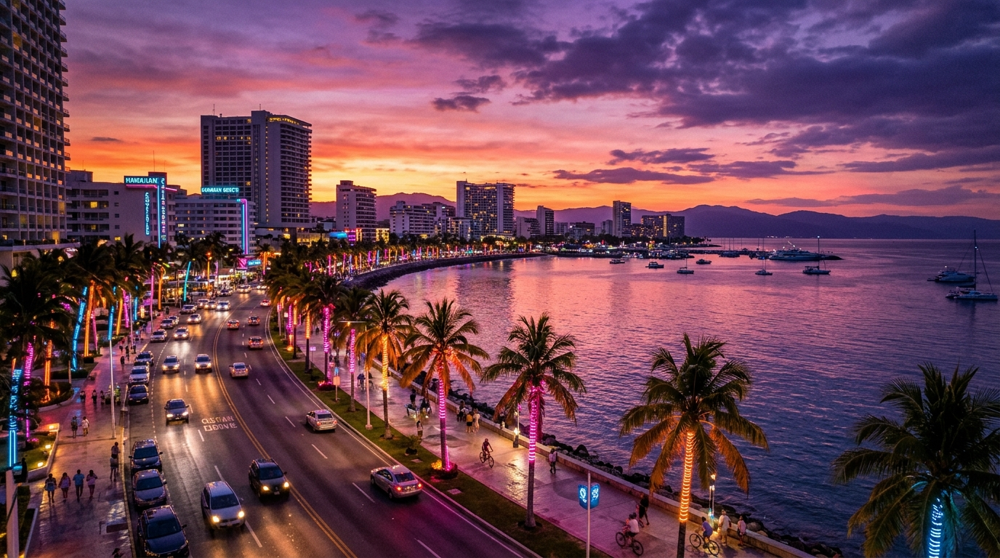

<div align="center">



# ZEUTUBE FM

**Vice Coast Live Streamer Directory for Grand Theft Auto VI**

*Find who is live right now across YouTube, Twitch, Kick, and TikTok — zero login, instant filtering, built for mobile.*

[](https://nextjs.org/)
[](https://www.typescriptlang.org/)
[](https://tailwindcss.com/)
[](https://www.netlify.com/)

</div>

---

## Welcome to Leonida

**Zeutube fm** is a fast, mobile-first live broadcast directory built to answer one question in under a second: **who is playing Grand Theft Auto VI live right now, and where can I watch them?**

No sign-in walls. No bloated player embeds. Open the page, scan the Vice sunset grid, and tap straight into the creator's broadcast on **YouTube**, **Twitch**, **Kick**, or **TikTok**.

---

## Key Features

- **Instant Platform Tabs** — Switch between `All`, `YouTube`, `Twitch`, `Kick`, and `TikTok` with zero page reloads or network refetches (last response cached in memory).
- **Multi-Platform Unified Cards** — Simulcasting creators appear on **one card** with a dedicated watch button for each active platform.
- **Featured Live Row** — Highlights flagship creators (`Kai Cenat`, `IShowSpeed`, `VanossGaming`, `Adin Ross`, `The Cowboys`, and anyone marked `featured: true`).
- **Kenyan Streamers Spotlight** — Dedicated `🇰🇪 KE` section surfacing Kenyan creators live on the Vice Coast.
- **Smart Sorting & Live Search** — Sort by **Most viewers** (default) or **Newest live**, and filter by streamer name in real time.
- **Quiet 60-Second Refresh** — Updates live counts and `"Updated just now"` timestamps silently in the background without flickering.
- **Offline Curated Roster** — Muted `"Not live right now"` section with direct channel links so fans can still find their favorite creators.
- **Built for Fast Mobile Data** — Skeleton loading cards, lazy-loaded 16:9 thumbnails with explicit dimensions, zero heavy UI libraries, and full support down to `360px` screens.

---

## Platform & API Architecture

All third-party API calls execute strictly on the server inside `lib/live-aggregator.ts`, exposed via both `app/api/live/route.ts` (Next.js) and `netlify/functions/live.ts` (Netlify Functions).

| Platform | Integration Strategy | Caching & Resilience |
| :--- | :--- | :--- |
| **Twitch** | Official Helix API (`client_credentials`), GTA VI category lookup + batched curated login checks | `60s` edge CDN cache (`s-maxage=60`) |
| **YouTube** | Quota-safe curated checks (`channels` → `playlistItems` → single batched `videos.list`) | Category `search.list` throttled to **once per 10 mins** in memory |
| **Kick** | Official public API client credentials with short timeout | Fails gracefully to curated channel links if unavailable |
| **TikTok** | Curated creator pass-through (`Check on TikTok` buttons) | No unverified live claims (no public live API) |
| **Demo Mode** | Activates automatically when API keys are omitted | Displays realistic live/offline preview + subtle `Demo data` tag |

---

## Vice Sunset Palette

Designed around a dark tropical neon dusk mood — high contrast, crisp tabular numerals, and `prefers-reduced-motion` support:

| Token | Hex | Usage |
| :--- | :--- | :--- |
| **Midnight Base** | `#0B0614` | Primary canvas background |
| **Velvet Card** | `#170B2A` | Streamer card & toolbar surfaces |
| **Neon Pink** | `#FF2E93` | Gradient start, active focus & TikTok accents |
| **Sunset Orange** | `#FF8A3D` | Gradient mid-stop & featured accents |
| **Golden Yellow** | `#FFD23F` | Headline highlights & demo mode indicator |
| **Electric Purple** | `#7B2FF7` | Gradient end & Twitch accents |
| **Tropical Teal** | `#00E5C7` | Kenyan Streamers spotlight & Kick accents |
| **Live Crimson** | `#FF3B3B` | Pulsing `LIVE` status badge |

---

## Quick Customization

### 1. Rename the App
All branding (`navbar`, `<title>`, OpenGraph tags, and footer) reads from a single constant in [`lib/config.ts`](lib/config.ts):

```ts
export const APP_CONFIG = {
  APP_NAME: 'Zeutube fm',
  // ...
};
```

### 2. Edit Curated Streamers
Update [`streamers.json`](streamers.json) at the project root:

```json
{
  "id": "kai-cenat",
  "displayName": "Kai Cenat",
  "avatarUrl": "",
  "featured": true,
  "country": "US",
  "youtubeChannelId": "TODO_YOUTUBE_CHANNEL_ID",
  "twitchLogin": "kaicenat",
  "kickSlug": "TODO_KICK_SLUG",
  "tiktokUsername": "kaicenat"
}
```

- Set `"featured": true` to pin the creator to the **Featured Live** row.
- Set `"country": "KE"` to highlight the creator in the **Kenyan Streamers** section with a `🇰🇪 KE` badge.
- Leave unknown handles prefixed with `TODO_` — they are ignored safely until filled in.

---

## Local Development

```bash
# 1. Install dependencies
npm install

# 2. Configure optional API keys (omit to run in Demo Mode)
cp .env.example .env.local

# 3. Start the development server
npm run dev
```

### Run Tests & Checks

```bash
# Pure logic & aggregator unit tests (node:test)
npx --yes tsx --test lib/stream-utils.test.ts lib/live-aggregator.test.ts

# TypeScript build & ESLint
npm run build
npm run lint
```

---

## Deploying to Netlify

`netlify.toml` is preconfigured for Next.js + Netlify Functions (`netlify/functions/live.ts`) with edge CDN caching:

1. Push this repository to GitHub, GitLab, or Bitbucket.
2. Create a new site in **Netlify** from your repository:
   - **Build command**: `npm run build`
   - **Publish directory**: `.next`
   - **Functions directory**: `netlify/functions`
3. Add your environment variables under **Site configuration → Environment variables**:
   - `YOUTUBE_API_KEY`
   - `TWITCH_CLIENT_ID`
   - `TWITCH_CLIENT_SECRET`
   - `KICK_CLIENT_ID` *(optional)*
   - `KICK_CLIENT_SECRET` *(optional)*
4. Deploy. Requests to `/api/live` automatically route to `/.netlify/functions/live` and cache at Netlify's edge CDN for 60 seconds (`Netlify-CDN-Cache-Control: public, s-maxage=60, stale-while-revalidate=120`).

---

## Project Structure

```text
├── app/
│   ├── api/live/route.ts       # Next.js server endpoint for live streams
│   ├── globals.css             # Vice sunset palette & reduced-motion rules
│   ├── layout.tsx              # Outfit + Plus Jakarta Sans font setup
│   └── page.tsx                # Main directory entry point
├── components/
│   ├── DirectoryClient.tsx     # In-memory cache, 60s polling, sections & filters
│   ├── HeroHeader.tsx          # Sunset backdrop, live counter & status strip
│   ├── Navbar.tsx              # Sticky platform filter tabs
│   ├── StreamerCard.tsx        # Unified live card (1 or multiple watch buttons)
│   ├── TikTokCard.tsx          # Curated TikTok profile cards
│   ├── OfflineRow.tsx          # Muted offline curated roster
│   └── SkeletonGrid.tsx        # Instant loading placeholders
├── lib/
│   ├── config.ts               # Central APP_NAME & cache constants
│   ├── live-aggregator.ts      # Twitch, YouTube, Kick, TikTok & Demo Mode engine
│   ├── stream-utils.ts         # Merging, filtering, sorting & formatting helpers
│   └── *.test.ts               # Node test runner unit tests
├── netlify/functions/live.ts   # Netlify serverless function wrapper
├── public/images/              # Local optimized sunset & stream preview assets
├── streamers.json              # Curated creator & Kenyan streamer seed list
├── netlify.toml                # Netlify build, function & redirect config
└── .env.example                # Server-side API key template
```

---

<div align="center">

<sub>Not affiliated with Rockstar Games or Take-Two Interactive. Stream links go to the streamers' own platforms.</sub>

</div>
